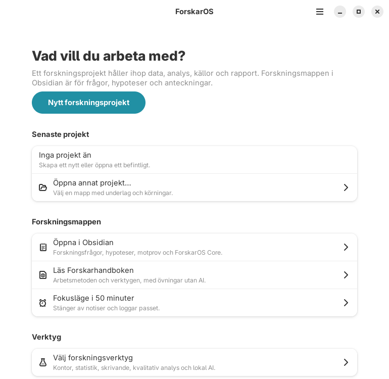
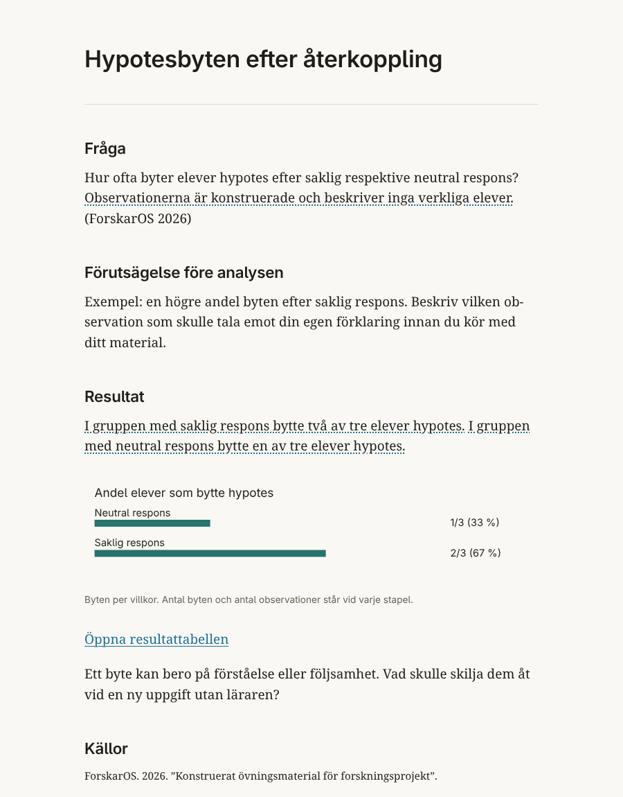
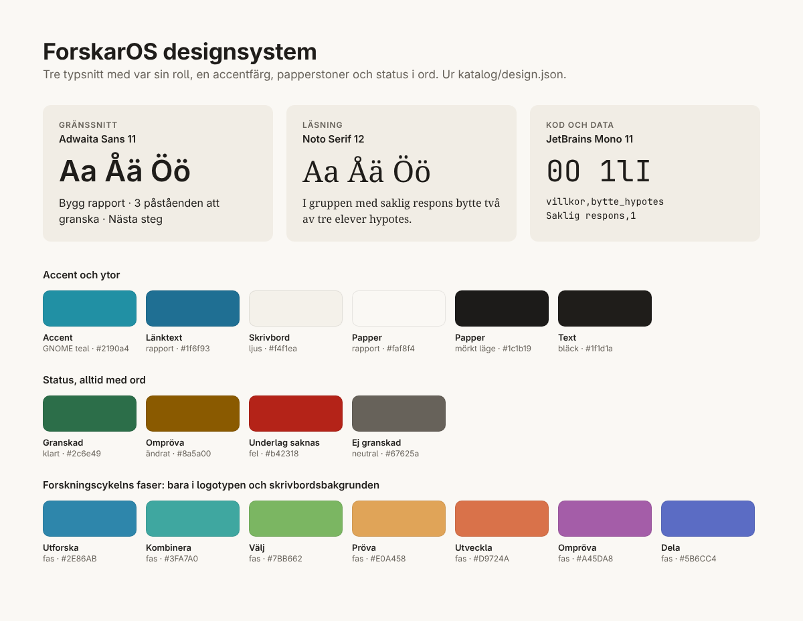

# Ändringslogg

Versioner släpps kvartalsvis (`2027.1`, `2027.2` …). Mellan släppen har standardgrenen versionen `ÅÅÅÅ.N-dev`. Se `docs/RELEASE.md`.

## 2027.1-beta4

### Appen ForskarOS

Ett fönster för forskningsprojekt, forskningsmappen och verktygen, byggt med GTK 4 och libadwaita. Den ersätter välkomstmenyn i terminalen, verktygslådan i terminalen och projektfönstret. [Designspråk](docs/DESIGN.md)

- **Ett nästa steg i taget.** Projektet visar ett steg med en knapp: granska, bygga, upprepa eller dela. Stegraden visar var du är. Det som är fel eller ändrat kommer först.
- *Om ForskarOS* visar den installerade systemutgåvan. I skyddade projekt avslutas arbetsflödet med lokal läsning.
- **Granska i serie.** *Granska* visar påståendena ett i taget med underlaget och går vidare efter varje bekräftelse. Ett påstående att ompröva visar vad som ändrats och kan öppna manuset direkt.
- **Koppla underlag** föreslår ID ur meningen, visar citat och sida bara för källpassager och kopierar länken.
- **Verktyg** installeras från appen. Obsidian (licens) och molntjänsterna kräver ett aktivt val i en dialog (`forskaros-setup --godkänt`). Installerade profiler visas som installerade.
- Grundinstallationens läge visas överst på startsidan och uppdateras av sig själv.
- Projektet läses om när du kommer tillbaka från Calc eller editorn. Senaste projekt visas på startsidan.
- Allt finns kvar på kommandoraden. `forskaros-projekt` utan kommando öppnar appen. Utan grafisk session visar `forskaros` välkomstmenyn i terminalen.
- **Rapportens läsyta:** seriff, smal spalt, papperston, ljust och mörkt läge, mobil och utskrift. Status står i ord i beläggen. Utseendet följer med i `underlag/rapport.css`, så upprepningar ger samma rapport. Äldre projekt byggs som förut.
- Appens självtest går igenom alla vyer med ett riktigt projekt under Xvfb i CI.

 

### Designsystem för hela ForskarOS

Färger och typsnitt finns på ett ställe, `katalog/design.json`, och når skrivbordet, appen, Obsidian och rapporten. [Designsystemet](docs/DESIGN.md)

- **Typsnitt med var sin roll:** Adwaita Sans för gränssnitt, Noto Serif för läsning och JetBrains Mono för kod och data. De gäller i GNOME, i alla program som ber om sans-serif, serif eller monospace, och i Flatpak-program som Firefox, LibreOffice och Obsidian. Avbildningen kontrollerar med `fc-match` att de används.
- **Accentfärgen teal** i GNOME, appen och nya forskningsmappar i Obsidian. Forskaren kan byta i Inställningar.
- **Lugnare skrivbordsbakgrund:** papperston med forskningscykeln stor och lätt, i ljust och mörkt läge.
- Rapportens färger och exempelfiguren kommer ur samma värden. All text i rapporten klarar WCAG AA i båda lägena, och testet kontrollerar det.
- Inget eget tema och inga låsta inställningar. Forskarens egna val går före.

### Forskningsdomänen

Forskningsprojektet blir en forskningsdomän, enligt [ForskarOS 3.0](docs/FORSKAROS-3.md). Acceptanstest 1–4 körs i CI.

- **Skyddat material:** välj skyddsnivå när projektet skapas. I ett skyddat projekt körs analysen och rapporten utan nätverk och utan åtkomst till hemkatalogen. Kan skyddet inte upprättas körs analysen inte alls. [Skyddat material](docs/PROJEKT.md#skyddat-material)
- **Täckningsgrad:** varje körning visas som dokumenterad, återkörbar eller återkörd. Upprepningar loggas, även misslyckade. [Hur säker är en körning?](docs/PROJEKT.md#hur-säker-är-en-körning)
- **Källpassager:** ett påstående kan kopplas till ett citat och en sida i en källa från Zotero. En ändrad eller borttagen källa och ett citat som inte står i källtexten upptäcks. [Koppla en källpassage](docs/PROJEKT.md#koppla-ett-påstående-till-en-källpassage)
- **Forskningspaket:** varje körning beskrivs i det öppna formatet RO-Crate (Process Run Crate). [Forskningspaketet](docs/PROJEKT.md#forskningspaketet)
- Projektets identitet, titel, skyddsnivå och licens finns i `projekt.json`. Äldre projekt fungerar som tidigare och behandlas som öppna.

## 2027.1-beta3

- Klicka på ett länkat påstående i rapporten för att läsa observationerna eller intervjuutdragen, se motbelägg och hitta analysfilen som forskaren valt.
- Granska ett påstående mot arbetsmaterialet. När ett kopplat urval, en metodfil eller påståendets lydelse ändras visar ForskarOS vad som behöver omprövas. Tidigare körningar bevarar den granskning som gällde då.
- Befintliga projekt kan få sina första kopplingar från projektfönstret. Exempel för Calc och Taguette ingår. [Prova omprövningen](docs/PROJEKT.md#pröva-en-rättelse).

- Forskningsprojekt kan startas från skrivbordet. Kalkyldata eller kodade intervjuutdrag, manus och en BibTeX-export blir en rapport med figur och referenser. Varje körning går att flytta och kontrollera separat. [Arbeta i ett projekt](docs/PROJEKT.md).

## 2027.1-beta2

- Vid första inloggningen visar verktygslådan hur grundinstallationen går. Du kan läsa startsidan utan nät, se installationsloggen eller öppna Obsidian och välja din forskningsmapp.
- I Core 0.3.1 kräver prestationsläget ett eget val när anteckningen har färre än 50 egna ord. Efter 50 ord öppnas dialogen i utvecklingsläge.
- De sju fasnamnen får plats på flera rader i smala paneler.

## 2027.1-beta1

Förhandsversion av 2027.1. Avbildningen byggs och testas i CI och amd64-disken har [provats i QEMU](docs/VM-TEST-2026-11-17.md).

- Faskraven och granskningen täcker alla begrepp i arbetsmetoden; varje begrepp har ett test som visar att systemet reagerar när det brister (`tests/begrepp.test.js`)
- Avslut med utfall, gräns för öppna frågor, varning när fler frågor påbörjas än avslutas
- Forskningsmöten följs upp (deltagare, kompetens, uppföljningar), trend för AI-användning
- Obsidian i egen profil

## 2027.1 (ej släppt)

- Avbildning byggd på Bluefin LTS för amd64 och arm64
- ForskarOS Core: faser med krav och beslutslogg, avslut med utfall, listan *Att åtgärda*, AI-konsultationer med logg, mallar, förmågegranskning, mått för forskningsmöten och fokuspass
- Verktygsprofiler genererade från en katalog, programmeny med en mapp per fas, verktygssidor i vaulten
- Grundverktyg installeras vid första start
- Diskavbildningar med kontot `forskare` (lösenordsbyte krävs), delad mapp, gästagenter för UTM/QEMU, UTM-paketering
- Logotyp och skrivbordsbakgrund, fokusläge med logg
- ForskarOS-labbet med R, tidyverse, RStudio Server och Python
- Forskarhandboken, tolv kapitel
