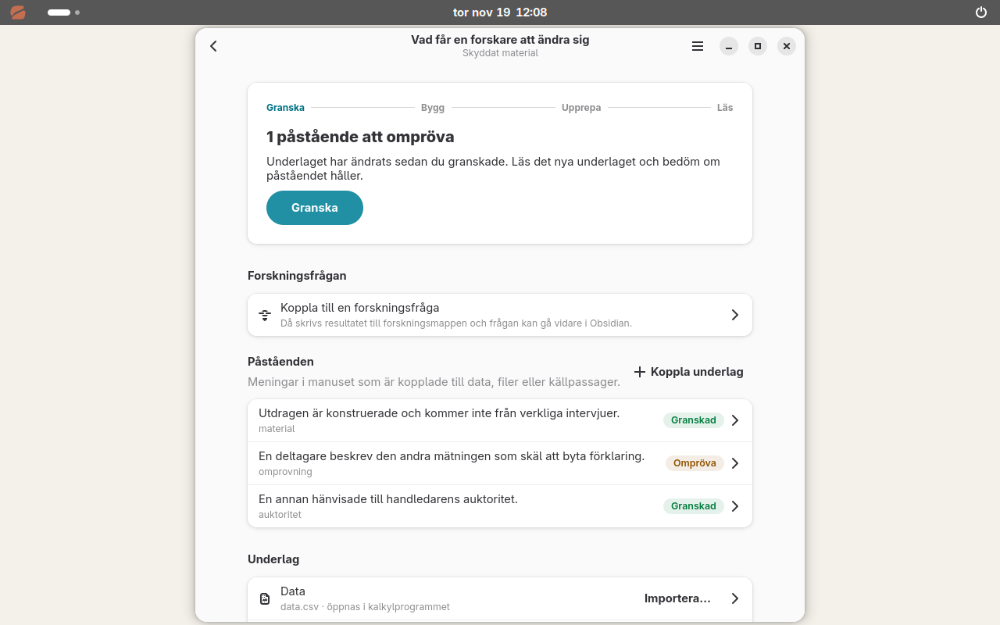

# DegsellOS

DegsellOS är en Linuxdistribution för forskare som vill kunna följa en slutsats tillbaka till underlaget. I skrivbordsappen kopplar du en mening i ditt manus till exempelvis en tabellrad eller ett intervjuutdrag. Rättar du utdraget markerar appen vilka meningar du behöver läsa om.

Varje analys sparas tillsammans med data, kod och rapport. En kollega kan öppna rapporten, följa en källhänvisning och köra om analysen. Skrivbordet är GNOME på Bluefin LTS.

## Ladda ner

**Förhandsversion 2027.1-beta5**

| Dator | Nedladdning | Installation |
|---|---|---|
| PC, virtuell maskin | [VM-disk för amd64](https://archive.org/download/degsellos-2027.1-beta5-amd64-vm/DegsellOS-2027.1-beta5-amd64.qcow2) | Importera disken i QEMU eller virt-manager och välj UEFI. |
| Mac med Apple Silicon | [UTM-maskin för arm64](https://archive.org/download/degsellos-2027.1-beta5-arm64-vm/DegsellOS-2027.1-beta5-arm64.utm.zip) | [Öppna i UTM](docs/MAC.md) |
| PC eller Intel-Mac, installation på disk | [Installations-ISO för amd64](https://archive.org/download/degsellos-2027.1-beta5-amd64-iso/DegsellOS-2027.1-beta5-amd64-interaktiv.iso) | [Installera på PC](docs/INSTALLATION.md#installera-på-pc) · [Intel-Mac](docs/MAC.md#intel-mac) |

I en färdig VM är både användarnamn och lösenord `forskare`. Du väljer ett eget lösenord vid första inloggningen. Vid installation på fysisk disk väljer du själv vilken disk som används. [Kontrollsummor för nedladdningarna](docs/VERSIONS.md#20271-beta5)

## Ditt första projekt

Öppna **DegsellOS → Nytt forskningsprojekt**. Välj observationstabeller eller kodade intervjuutdrag för att börja med exempeldata. Under **Granska** ser du meningen i manuset och de källor du kopplat till den. Välj **Bygg rapport** för att spara en körning och **Upprepa** för att kontrollera resultaten. [Guide till forskningsprojekt](docs/PROJEKT.md)

Du kan även använda **DegsellOS Core** i en befintlig Obsidian-installation. Tillägget samlar forskningsfrågor, hypoteser och granskningsbeslut i lokala Markdown-filer. [Installera Core](docs/CORE.md)

[Dokumentation](docs/README.md) · [Verktygskatalog](vault/00%20START/Verktyg/Översikt.md) · [Projektskydd](docs/SECURITY.md) · [Bidra och bygga från källkod](CONTRIBUTING.md) · [Ändringslogg](CHANGELOG.md) · [MIT-licens](LICENSE)

`main` innehåller utvecklingsversionen. Förändringar efter beta5 beskrivs under *Under utveckling* i ändringsloggen.
