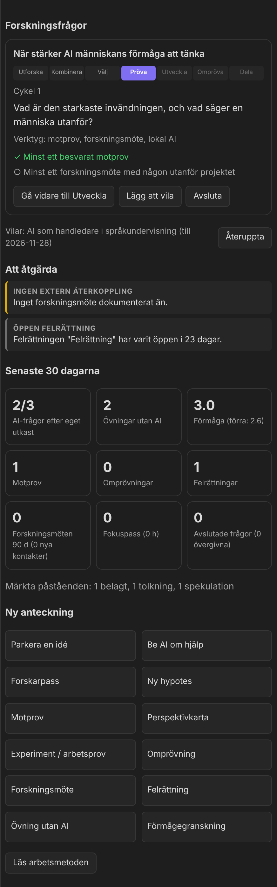

# ForskarOS

Linuxdistribution för forskningsarbete, byggd som ett lager ovanpå [Bluefin LTS](https://projectbluefin.io/). Den innehåller:

- **Forskningsverktyg** i profiler som installeras efter behov. Programmenyn har en mapp per arbetsfas.
- **ForskarOS Core**, ett Obsidian-tillägg som strukturerar forskningsprojekt i faser och listar det som saknas.
- **ForskarOS-labbet**, en containeravbildning med R och Python för analyser som kan köras om i samma miljö.

Status: avbildningen byggs i CI för amd64 och arm64. Den har inte startats på riktig hårdvara eller i en virtuell maskin än.

<p align="center"></p>

<sub>Panelen renderad från tilläggets kod med ett exempelvalv (`node scripts/skarmdumpar.js`). Inte en skärmdump av ett körande system.</sub>

## ForskarOS Core

Ett Obsidian-tillägg. Allt sker lokalt; tillägget gör inga nätverksanrop.

- **Faser:** varje forskningsfråga går igenom Utforska, Kombinera, Välj, Pröva, Utveckla, Ompröva och Dela. Varje fas har krav (till exempel ett besvarat motprov och ett möte med någon utanför projektet innan Pröva är klar). Kraven går att hoppa över, men motiveringen loggas i frågan.
- **Avslut:** en fråga avslutas med ett utfall: besvarad, hypotesen förkastad eller övergiven.
- **Att åtgärda:** en lista som bygger på vaultens innehåll, till exempel hypoteser utan motprov, frågor som stått still i 30 dagar, fler påbörjade än avslutade frågor och för många öppna frågor (vilande räknas).
- **AI-konsultationer:** tillägget skapar en text att kopiera till valfri AI och loggar konsultationen. Utvecklings- och prövningsläget kräver att anteckningen har minst 50 egna ord.
- **Mallar** för forskningsfrågor, hypoteser, motprov, perspektivkartor, experiment, omprövningar, forskningsmöten, felrättningar, övningar och en månatlig förmågegranskning.

Arbetsmetoden beskrivs i [`vault/00 START/Arbetsmetod.md`](vault/00%20START/Arbetsmetod.md) och bakgrunden i [`Bakgrund.md`](vault/00%20START/Bakgrund.md).

### Prova utan att installera OS:et

```bash
bash scripts/install-vault.sh   # skapar ~/ForskarOS, skriver aldrig över
```

Öppna `~/ForskarOS` som vault i Obsidian och aktivera ForskarOS Core under *Settings → Community plugins*.

## Verktyg

Verktygen definieras i [`katalog/verktyg.json`](katalog/verktyg.json). Därifrån genereras profiler, programmenyns mappar och en sida per verktyg i vaulten (`python3 scripts/generera.py`).

| Profil | Innehåll |
|---|---|
| Grund (installeras vid första start) | Firefox, LibreOffice, Zotero, JASP, Xournal++, Déjà Dup |
| Obsidian (krävs för ForskarOS Core) | Obsidian; inte öppen källkod, installeras efter licensgodkännande |
| Rekommenderat urval | Tio verktyg ur övriga profiler |
| Skriva och publicera | Zettlr, ONLYOFFICE, TeXstudio, Pandoc, Typst |
| Statistik och data | jamovi, LabPlot, R, DuckDB, JupyterLab |
| Programmering | VSCodium, uv, git-annex, DataLad, ripgrep |
| Kvalitativ forskning | Speech Note, Taguette |
| Idéer och modeller | draw.io, Freeplane, Rnote |
| Lokal AI | Ollama, Alpaca |
| AI-tjänster i molnet (tillval) | Genvägar till Perplexity, Elicit, Consensus |

```bash
forskaros-setup                       # välj profiler interaktivt
forskaros-setup --profil statistik    # installera en profil
forskaros-setup --lista               # visa profilerna
```

Allt utom Obsidian och molntjänsterna är öppen källkod. CI kontrollerar att varje verktyg finns för både amd64 och arm64 på Flathub, Homebrew eller PyPI.

## Labbet

```bash
forskaros-labb Rscript analys.R   # kör ett kommando i labbet, i aktuell mapp
forskaros-labb rstudio            # RStudio Server på localhost:8787
forskaros-labb version            # avbildningens digest, för att kunna köra om analysen
```

`ghcr.io/jtensetti/researchos-labb` bygger på `rocker/tidyverse:4.6.2` med Python 3.13 tillagt, och fungerar med Podman eller Docker på andra system.

## Hårdvara

| Maskin | Sätt |
|---|---|
| PC (x86_64) | Installations-ISO |
| Intel-Mac | Installations-ISO; T2-modeller kan behöva extra drivrutiner |
| Apple Silicon | Virtuell maskin i UTM, se [`docs/MAC.md`](docs/MAC.md) |

Diskavbildningarna för virtuella maskiner har kontot `forskare` med lösenordet `forskare`, som måste bytas vid första inloggningen.

## Bygga

```
Containerfile          FROM ghcr.io/ublue-os/bluefin:lts
build_files/build.sh   körs i avbildningen under bygget
system_files/          kommandon, tjänster, inställningar
vault/                 vaulten och ForskarOS Core
katalog/               verktygskatalogen
labb/                  labbets Containerfile
disk_config/           inställningar för ISO och diskavbildningar
```

- **Avbildning:** varje push bygger för amd64 och arm64. Pushar till standardgrenen publiceras som `ghcr.io/jtensetti/researchos:latest` och signeras med cosign.
- **Diskar:** arbetsflödet *Bygg installationsmedia* gör ISO och qcow2 som nedladdningsbara artefakter.
- **Byta en befintlig Bluefin LTS-installation:** `sudo bootc switch ghcr.io/jtensetti/researchos:latest`
- **Versioner:** kvartalsvis (`2027.1`, `2027.2` …), se [`docs/RELEASE.md`](docs/RELEASE.md) och [`CHANGELOG.md`](CHANGELOG.md).

## Tester

```bash
bash scripts/check.sh
```

Kör tester för tilläggets regler, tillägget mot ett simulerat Obsidian-API, skalskripten, verktygsprofilerna, UTM-paketeringen, labbkommandot och länkarna i vaulten.

## Licens

Projektets kod: MIT ([`LICENSE`](LICENSE)). Bluefin, CentOS Stream, GNOME och verktygen har sina egna licenser. Obsidian är proprietärt och ingår inte i avbildningen.
