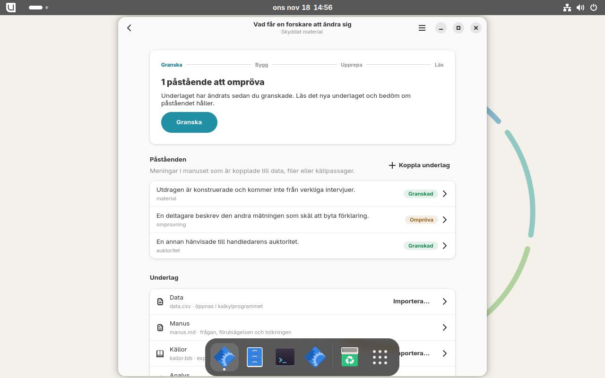

# ForskarOS

En Linuxdistribution för forskningsarbete, byggd på Bluefin LTS med GNOME.

ForskarOS samlar underlag, analys och manus i lokala projekt. Koppla ett påstående till en tabellrad, ett intervjuutdrag eller en källpassage. När underlaget ändras visar appen vilka påståenden som behöver granskas igen. Varje analys sparas tillsammans med sina underlag och resultat och kan upprepas på en annan dator.

## Ladda ner

Senaste förhandsversion: **2027.1-beta4**.

| Plattform | Nedladdning | SHA-256 |
|---|---|---|
| PC och Intel-Mac · installation | [Installations-ISO](https://archive.org/download/forskaros-2027.1-beta4-amd64-iso/ForskarOS-2027.1-beta4-amd64-interaktiv-r2.iso) | [Kontrollsumma](https://archive.org/download/forskaros-2027.1-beta4-amd64-iso/ForskarOS-2027.1-beta4-amd64-interaktiv-r2.iso.sha256) |
| PC · virtuell maskin | [amd64-disk](https://archive.org/download/forskaros-2027.1-beta4-amd64-vm/ForskarOS-2027.1-beta4-amd64.qcow2) | [Kontrollsumma](https://archive.org/download/forskaros-2027.1-beta4-amd64-vm/ForskarOS-2027.1-beta4-amd64.qcow2.sha256) |
| Apple Silicon · UTM | [arm64-disk](https://archive.org/download/forskaros-2027.1-beta4-arm64-vm/ForskarOS-2027.1-beta4-arm64.qcow2) | [Kontrollsumma](https://archive.org/download/forskaros-2027.1-beta4-arm64-vm/ForskarOS-2027.1-beta4-arm64.qcow2.sha256) |

**Använd ISO-filen med ändelsen `-interaktiv-r2.iso`.** Den första beta4-ISO:n kan radera anslutna diskar utan diskval. [Installation och kontrollsummor](docs/INSTALLATION.md) · [Mac och UTM](docs/MAC.md)

VM-diskarna har kontot `forskare` med lösenordet `forskare`. Lösenordet måste bytas vid första inloggningen.

## Kom igång

1. Öppna **ForskarOS** och välj **Nytt forskningsprojekt**. Börja med exempeldata för observationer eller kodade intervjuutdrag.
2. Välj **Granska** och läs manusets påståenden tillsammans med deras underlag.
3. Välj **Bygg rapport** och sedan **Upprepa** för att kontrollera att resultaten kan återskapas.
4. Byt till ditt eget material. När ett kopplat underlag ändras visar appen **Ompröva** vid det berörda påståendet.

[Arbeta med forskningsprojekt](docs/PROJEKT.md)

## Det här ingår

- **Projekt och rapporter.** CSV, Markdown och BibTeX blir en HTML-rapport med figur, referenser och klickbara belägg. Körningar sparas med kontrollsummor och RO-Crate-metadata.
- **Skyddade analyser.** Analys och rapportbygge kan köras utan nätverk och med hemkatalogen dold. [Skyddets omfattning](docs/SECURITY.md)
- **Forskningsverktyg.** Zotero, LibreOffice och andra grundverktyg hämtas vid nätanslutning. Fler verktyg väljs i appen. [Verktygsöversikt](vault/00%20START/Verktyg/Översikt.md)
- **R och Python.** ForskarOS-labbet erbjuder en containerbaserad analysmiljö som kan bindas till en viss avbildning.
- **ForskarOS Core.** Ett valfritt Obsidian-tillägg för forskningsfrågor, hypoteser, motprov och beslutslogg. [Använd Core separat](docs/CORE.md)

## Dokumentation och utveckling

[Dokumentation](docs/README.md) · [Bidra och köra tester](CONTRIBUTING.md) · [Arkitektur](docs/ARCHITECTURE.md) · [Ändringslogg](CHANGELOG.md) · [Färdplan](docs/ROADMAP.md)

`main` innehåller utvecklingsversionen. Förändringar efter beta4 beskrivs under *Under utveckling* i ändringsloggen.

Projektets kod har [MIT-licens](LICENSE). Bluefin, GNOME och de medföljande verktygen har egna licenser. Obsidian installeras separat efter ett aktivt val.
