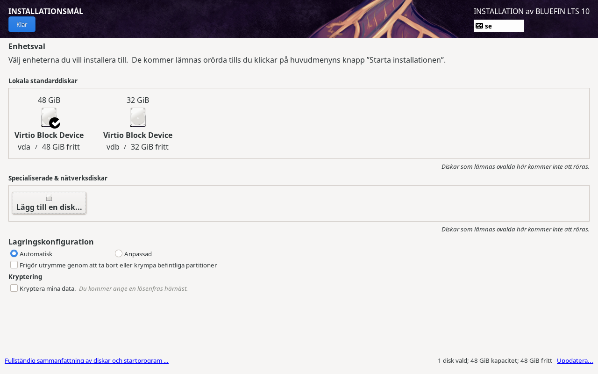

# ForskarOS 2027.1-beta4

## Installationsmedier

| Plattform | Originalfil | SHA-256 |
|---|---|---|
| PC och Intel-Mac | [Interaktiv ISO, revision r2](https://archive.org/download/forskaros-2027.1-beta4-amd64-iso/ForskarOS-2027.1-beta4-amd64-interaktiv-r2.iso) | `289914752f514402f77b21f7b584c9ed6c0b1fadbe214a01bf254ac813e82099` |
| Virtuell PC | [VM-disk för amd64](https://archive.org/download/forskaros-2027.1-beta4-amd64-vm/ForskarOS-2027.1-beta4-amd64.qcow2) | `e07bd61f2fca2b6e40830b9122171c184dc2bf14a674124835550e3110f84105` |
| Apple Silicon | [VM-disk för arm64](https://archive.org/download/forskaros-2027.1-beta4-arm64-vm/ForskarOS-2027.1-beta4-arm64.qcow2) | `4a56bfd88ae2ca2a978dccf2b50018d7478a701fd60053f5d4f302e0b5074c60` |

Jämför den hämtade filens SHA-256 med värdet i tabellen. På Linux kan du använda `sha256sum FILNAMN`, på macOS `shasum -a 256 FILNAMN` och i PowerShell `Get-FileHash FILNAMN -Algorithm SHA256`.

## Installera på PC

1. Starta datorn från filen som slutar på **`-interaktiv-r2.iso`**. Beta4:s startmeny visar **Bluefin LTS 10**. Välj **Svenska (Sverige)** i installeraren.
2. Öppna **Installationsmål**. Flera diskar kan vara förvalda. Avmarkera alla utom den du vill installera på. Kontrollera diskens storlek och att sammanfattningen visar **1 disk vald** innan du väljer **Klar**.
3. Välj tangentbord och tidszon. Aktivera nätverkskortet under **Nätverk & värdnamn** om du vill hämta grundverktygen vid första inloggningen.
4. Välj **Börja installation**. När installationen är klar, ta ut installationsmediet och starta datorn från systemdisken.



### Äldre ISO-filer

Den ursprungliga `ForskarOS-2027.1-beta4-amd64.iso` kan partitionera anslutna diskar automatiskt. Revisionen `-interaktiv.iso` kan stanna vid det svenska språkvalet. Använd `-interaktiv-r2.iso` för en ny installation.

## Byt till beta4 från en befintlig ForskarOS-installation

```bash
sudo bootc switch ghcr.io/jtensetti/researchos:2027.1-beta4
sudo systemctl reboot
```

Efter omstart visar `cat /usr/share/forskaros/RELEASE` den installerade versionen. Det signerade flerarkitektursmanifestet för beta4 har digest `sha256:a2aa2f6d758df4c6cc4b11cfddcffcb0fb46460b2cd4796473e3d83600189bc0`. [Systemavbildning](https://github.com/Jtensetti/researchOS/actions/runs/44297403777) · [Installations-ISO](https://github.com/Jtensetti/researchOS/actions/runs/44313541729)
