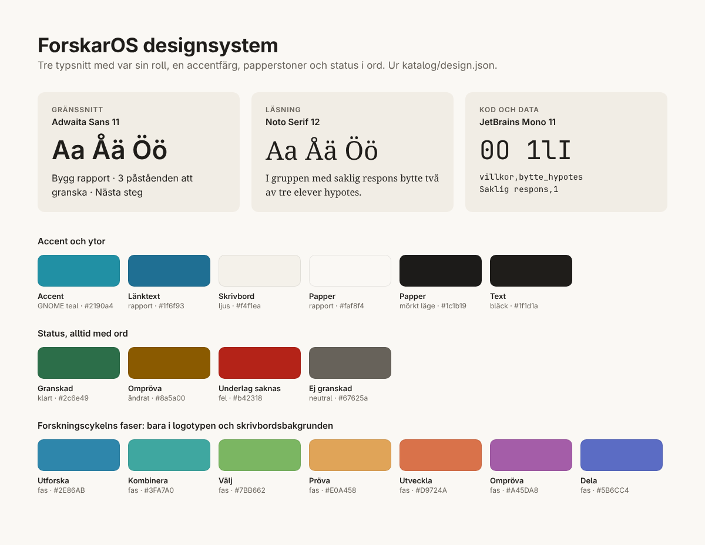
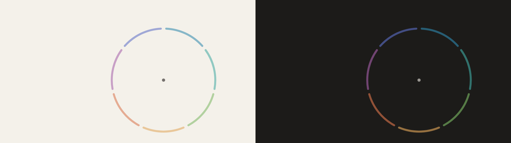

# Designsystem

Färger och typsnitt definieras i [katalog/design.json](../katalog/design.json). Generatorn `scripts/identitet.py` använder dem för logotyp, skrivbordsbakgrunder, GNOME, fontconfig, Obsidian och rapporternas stilmall.

## Gränssnitt

Skrivbordsappen använder GTK 4 och libadwaita. Den följer GNOME:s ljusa och mörka läge, accentfärg och textskalning.

| Princip | Tillämpning |
|---|---|
| En primär handling per vy | Nästa steg visas med en fylld knapp. Övriga handlingar ligger i rader, menyer eller vanliga knappar. |
| Status i ord | *Granskad*, *Ompröva* och *Underlag saknas* visas i text, även när färg används. |
| Projektets aktuella läge styr | Ändrat eller saknat underlag visas före rapportbygge och delning. Logiken finns i `oversikt.py`. |
| Tydliga följder | Import som ersätter en arbetsfil bekräftas. Sparade körningar bevarar tidigare underlag och resultat. |
| Systemets komponenter | Adwaitas kort, dialoger och symboliska ikoner används genomgående. |

## Typografi

| Roll | Typsnitt | Användning |
|---|---|---|
| Gränssnitt | Adwaita Sans 11 | GNOME, appen, Obsidian och rapportrubriker |
| Läsning | Noto Serif 12 | Dokument och rapporternas brödtext |
| Kod och data | JetBrains Mono 11 | Terminal, analyskod och datatabeller |

GNOME får standardvärden via dconf. Fontconfig anger familjerna för sans-serif, serif och monospace. `forskaros-init` installerar motsvarande användarkonfiguration för Flatpak-program en gång. Obsidians utseende sätts när en ny vault skapas.

Appen använder Adwaitas stilklasser för rubriker och brödtext. Rapporten har 19 px brödtext, radavstånd 1,55 och högst 68 tecken per rad, med reservtypsnitt för andra datorer.

## Färger och status

| Roll | Ljust läge | Mörkt läge |
|---|---|---|
| Accent i GNOME | `teal` | `teal` |
| Rapportens länkar | `#1f6f93` | `#5fb3d6` |
| Skrivbordsbakgrund | `#f4f1ea` | `#1c1b19` |
| Rapportens bakgrund | `#faf8f4` | `#1c1b19` |
| Rapportens text | `#1f1d1a` | `#ebe7e0` |

| Status | Stil i appen | Betydelse |
|---|---|---|
| Granskad, Återkörd | `success` | Granskad mot aktuellt underlag, eller upprepad med samma resultat |
| Ompröva | `warning` | Ett kopplat underlag eller påståendets lydelse har ändrats |
| Underlag saknas | `error` | En fil, källa eller ett citat saknas |
| Ej granskad, Dokumenterad, Återkörbar | Neutral | Granskning eller upprepning saknas |

Rapportens textfärger kontrolleras mot bakgrunderna med minst 4,5:1 i kontrast i båda lägena. Forskningscykelns sju fasfärger används i logotypen och bakgrunden.

## Skrivbord och komponenter

Dockan börjar med ForskarOS och fortsätter med forskningsverktyg. Programmenyn grupperar verktyg efter arbetsfas. Första inloggningen öppnar ForskarOS med grundinstallationens läge.

Appen använder `Adw.PreferencesGroup`, `Adw.ActionRow` och `Adw.Clamp` för grupper och läsbredd. Den primära knappen har `suggested-action` och `pill`. Stegraden visar *Granska, Bygg, Upprepa, Dela* eller *Läs* för skyddade projekt, med text som också kan läsas av skärmläsare.

Inställningarna är standardvärden som användaren kan ändra. En borttagen fontconfig-fil återskapas inte automatiskt. Befintliga Obsidian-inställningar bevaras.

## Text i gränssnittet

Använd svenska, du-tilltal och korta meningar. Knappar börjar med ett verb: *Bygg rapport*, *Granska*, *Upprepa*. Hjälptext förklarar följden av valet, exempelvis att analysen körs utan nätverk. Felmeddelanden anger vad som gick fel och hur användaren kan gå vidare.

## Ändra designen

1. Ändra `katalog/design.json`.
2. Kör `python3 scripts/identitet.py`.
3. Kör `bash scripts/check.sh` för att kontrollera genererade filer, typsnitt och kontrast.

Ett nytt typsnitt behöver också läggas till i `build_files/build.sh`, som installerar paketet och kontrollerar familjen med `fc-match`.
