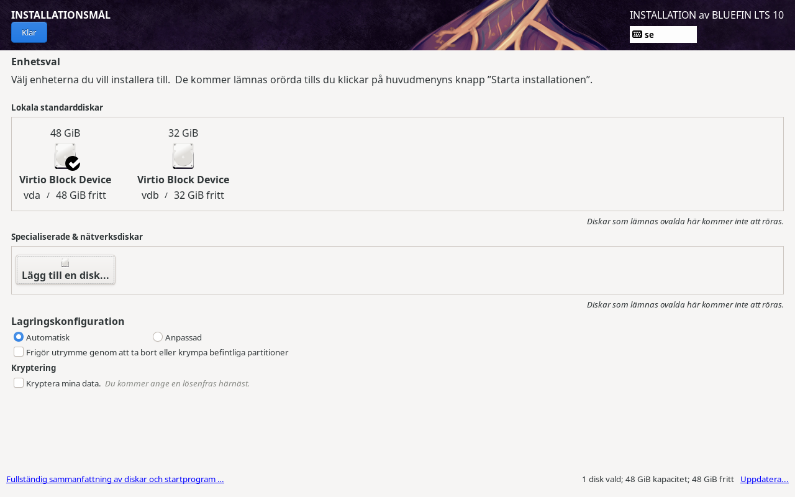

# Installera DegsellOS

DegsellOS finns som installations-ISO för amd64 och färdiga VM-diskar för amd64 och arm64. [Hämta senaste förhandsversionen](../README.md#ladda-ner). På Apple Silicon används [UTM-guiden](MAC.md).

## Kontrollera nedladdningen

Hämta avbildningen och dess `.sha256`-fil till samma mapp. De publicerade summorna finns också i [versionsreferensen](VERSIONS.md). Kör kontrollen i den mappen innan du använder avbildningen.

På Linux, för installations-ISO:n:

```bash
sha256sum -c ForskarOS-2027.1-beta4-amd64-interaktiv-r2.iso.sha256
```

På macOS, för arm64-disken:

```bash
shasum -a 256 -c ForskarOS-2027.1-beta4-arm64.qcow2.sha256
```

För amd64-disken används motsvarande `.qcow2.sha256`-fil. Resultatet ska vara `OK`. En avvikelse innebär att nedladdningen inte matchar den publicerade kontrollsumman.

I PowerShell kan du använda `Get-FileHash FILNAMN -Algorithm SHA256` och jämföra med värdet i versionsreferensen.

### Äldre beta4-medier

| Filnamnets slut | Användning |
|---|---|
| `-amd64-interaktiv-r2.iso` | Aktuell installerare med diskval och stöd för svenskt språkval |
| `-amd64-interaktiv.iso` | Ersatt; kan stanna vid svenskt språkval |
| `-amd64.iso` | Ersatt; kan partitionera anslutna diskar automatiskt |

**Använd endast `-interaktiv-r2.iso` för installation.** Hämta den aktuella filen om du har någon av de äldre varianterna.

## Installera på PC

Installationen ändrar partitionerna på den valda disken. Säkerhetskopiera dess innehåll först. Koppla gärna bort andra diskar under installationen.

1. Skriv ISO-filen som en diskavbildning till ett USB-minne med ett program för startbara medier. I en virtuell maskin ansluter du filen som en virtuell CD/DVD.
2. Starta datorn från mediet i UEFI-läge. Beta4:s startmeny och installerare använder basdistributionens namn **Bluefin LTS 10**.
3. Välj **Svenska (Sverige)**. Öppna **Installationsmål** och välj endast den disk som DegsellOS ska installeras på. Flera diskar kan vara förvalda; kontrollera namn, storlek och antalet valda diskar innan du väljer **Klar**.
4. Kontrollera tangentbord och tidszon. Aktivera nätverket under **Nätverk & värdnamn** om grundverktygen ska hämtas vid första inloggningen. Ett lokalt konto kan skapas i installeraren eller i skrivbordets välkomstguide.
5. Välj **Börja Installation**. När installationen är färdig tar du bort USB-minnet eller kopplar från ISO-filen och startar från systemdisken.
6. Slutför GNOME:s välkomstguide. Öppna **DegsellOS** för att skapa ditt första projekt.



## Virtuell PC

Importera amd64-filen med ändelsen `.qcow2` som en befintlig disk i QEMU eller virt-manager. Välj x86_64, UEFI, ett VirtIO-diskgränssnitt och nätverk med NAT. En lämplig startkonfiguration är 4 processorkärnor och 4 GB minne; större analyser kan behöva mer.

Disken är redan installerad. Starta direkt från den utan ISO. Logga in som `forskare` med lösenordet `forskare` och välj ett nytt lösenord när du uppmanas.

## Första projektet och verktygen

Skrivbordsappen, Python och Pandoc ingår i systemet. Exempelprojekten kan granskas, köras och upprepas innan externa verktyg har installerats.

Grundverktygen hämtas automatiskt från Flathub när nätåtkomst finns. Startsidan visar installationens läge. Välj **Välj forskningsverktyg** för ytterligare profiler. Obsidian är ett separat tillval.

[Skapa ett forskningsprojekt](PROJEKT.md) · [DegsellOS Core](CORE.md)

## Uppdatera en befintlig installation

Följ utvecklingsavbildningen under namnet DegsellOS:

```bash
sudo bootc switch ghcr.io/jtensetti/degsellos:latest
sudo systemctl reboot
```

DegsellOS hette tidigare ForskarOS. Datorer som installerades under det namnet följer `ghcr.io/jtensetti/researchos`, som får samma avbildning, så de uppdateras utan att du behöver göra något. Vid första inloggningen efter uppdateringen flyttas forskningsmappen från `~/ForskarOS` till `~/DegsellOS`, tillsammans med appens inställningar och Core-tillägget. Den släppta beta4-utgåvan finns kvar som `ghcr.io/jtensetti/researchos:2027.1-beta4`.

Visa installerad version och aktuell systemavbildning:

```bash
cat /usr/share/degsellos/RELEASE
bootc status
```

Utvecklingsavbildningen använder taggen `latest`. Den uppdateras löpande. Versionsmärkta utgåvor har separata taggar. Säkerhetskopiera forskningsprojekten inför ett versionsbyte och upprepa en sparad körning efter uppdateringen.
