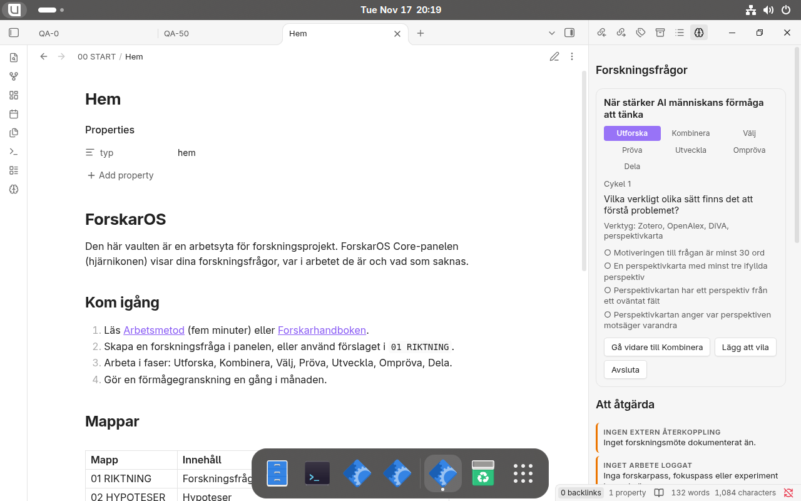

# Installera ForskarOS Core i Obsidian

ForskarOS Core är ett Obsidian-tillägg för forskningsfrågor, hypoteser, motprov och beslut. Anteckningarna sparas som Markdown på datorn.

1. Installera Obsidian och hämta ForskarOS källkod.
2. Öppna en terminal i repots rot och kör `bash scripts/install-vault.sh`. Som standard skapas forskningsmappen `~/ForskarOS`. Ange en ledig sökväg som argument om mappen redan finns.
3. Öppna mappen som ett valv i Obsidian. Tillåt community-tillägg och aktivera **ForskarOS Core** under **Settings → Community plugins**.
4. Öppna **00 START → Hem** och välj **Ny forskningsfråga** i Core-panelen.

På ett ForskarOS-skrivbord skapas forskningsmappen vid första inloggningen. Välj Obsidian i appens verktygslista om du vill använda tillägget. [Arbetsmetoden](../vault/00%20START/Arbetsmetod.md)

