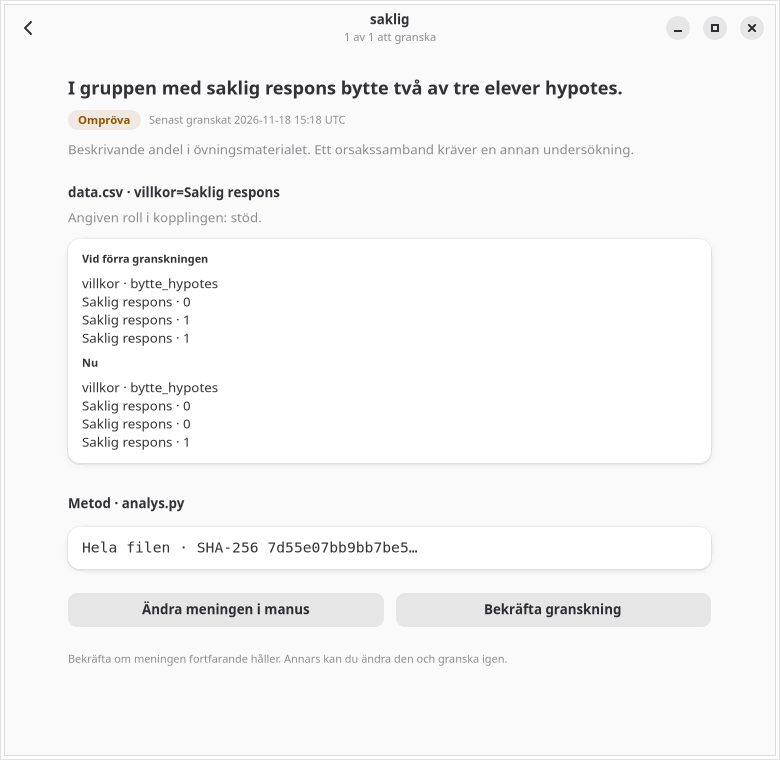

# Arbeta i ett forskningsprojekt

Öppna **ForskarOS → Nytt forskningsprojekt**. Appen skapar en mapp i `~/Forskningsprojekt` med exempeldata, ett manus och en analys. Välj exempel efter materialet du vill arbeta med.

| Projektmall | Underlag |
|---|---|
| Kvantitativ | En CSV-tabell med kolumnerna `villkor` och `bytte_hypotes` (0 eller 1). Exempelanalysen beräknar antal och andelar per villkor. |
| Kvalitativ | Kodade intervjuutdrag från Taguette. CSV-exporten innehåller `id,document,tag,content`. Figuren visar antal distinkta utdrag per kod. |
| Källtolkning (utvecklingsversion) | Två skriftliga källor som beskriver samma händelse olika. Koppla de båda passagerna till tolkningen i manuset. |

Under **Underlag** kan du importera egna data, manus och BibTeX-referenser. CSV-filer kan använda komma eller semikolon och ska vara kodade i UTF-8. Anpassa `underlag/analys.py` om din tabell har andra kolumner. Manus och analys kan redigeras i valfri texteditor.

## Koppla ditt eget material

1. Skriv meningen i `underlag/manus.md`. Välj **Koppla underlag** i appen och klistra in meningen.
2. Välj en tabellrad, ett utdrag, en källpassage eller en projektfil. Ange om underlaget är **stöd**, **motbelägg** eller **metod**. Använd samma påstående-ID för att koppla flera underlag till meningen.
3. Välj **Spara och kopiera länk**. Ersätt meningen i manuset med den kopierade Markdown-länken.
4. Välj **Granska**, läs underlaget och bekräfta din bedömning.


Urval och filkopplingar finns i `underlag/belagg.json`. Ett tabellurval omfattar alla matchande rader, även dubbletter. Vyn visar upp till 40 rader. Om radordningen är avgörande för analysen kan du koppla hela filen i stället. För intervjuutdrag kan du lägga till originaltexten som en egen källa.

## Pröva en rättelse

Granska påståendena i ett kvantitativt exempelprojekt och välj **Bygg rapport**. Öppna därefter CSV-filen i Calc och ändra en etta till en nolla i gruppen *Saklig respons*. När du återgår till ForskarOS får påståendet om den gruppen status **Ompröva**. Påståendet om den neutrala gruppen behåller sin granskning. För intervjumaterial kan du på samma sätt granska både ett citat som stöder tolkningen och ett avvikande utdrag.

I utvecklingsversionen visas det tidigare och det aktuella underlaget under rubrikerna **Vid förra granskningen** och **Nu** när jämförelsetext har sparats. Välj **Ändra meningen i manus** eller **Bekräfta granskning**. Vill du läsa den tidigare tolkningen öppnar du **Rapport** på den äldre körningens rad.



Granskningsbeslut sparas i `underlag/granskningar.json`. Den separata filen `granskningsunderlag.json` i projektmappen kan innehålla äldre citat efter en rättelse. Den följer med när hela projektet kopieras.

## Koppla ett påstående till en källpassage

I beta4 kan du importera en BibTeX-export från Zotero under **Underlag**. Välj sedan **Koppla underlag → Källpassage** och ange citat och sida. Om du lägger källtexten i `underlag/kallor/` kan ForskarOS även kontrollera att citatet finns i texten.

I utvecklingsversionen går det att hämta en PDF-markering direkt från Zotero på samma dator.

1. Öppna Zotero och tillåt lokala program under **Inställningar → Avancerat**. Kopiera en markering i PDF-läsaren. Aktivera Zotero-länkar för Markdown under **Export** om den kopierade markeringen saknar länk.
2. Välj **Koppla underlag → Hämta markering från Zotero** i ForskarOS och klistra in markeringen.
3. Kontrollera titel, citat och sida. Välj **Lägg till källa och använd citat**. Referensen sparas i `kallor.bib`.

En ändrad titel, författare eller DOI kräver en ny granskning av källan. En ny filsökväg från Zotero påverkar inte granskningen. [Zoteros lokala API](https://www.zotero.org/support/dev/web_api/v3/local_api)

## Bygg och upprepa rapporten

**Bygg rapport** sparar en kopia av arbetsunderlaget i `korningar/` och kör analysen på kopian. Rapport, figur och resultattabell ligger i körningens `resultat/`. Rapporten går att läsa direkt i ForskarOS. Om du delar HTML-filen separat, lägg `resultat.csv` bredvid den så att länken till tabellen fungerar.

**Upprepa** kör analysen på nytt och jämför resultaten med de sparade SHA-256-summorna. På en annan dator kan du öppna hela körningsmappen från projektmenyn eller köra `python3 upprepa.py` i mappen. För lokala körningar behövs Python 3 och Pandoc 3. Versionerna från originalkörningen finns i `korning.json`. Andra programversioner eller okontrollerad slump kan ge andra resultat; kontrollen jämför filerna byte för byte.

| Status | Innebörd |
|---|---|
| Dokumenterad | Underlag, resultat och programversioner finns förtecknade. |
| Återkörbar | Körningen gjordes i en isolerad miljö med nätverket avstängt. |
| Återkörd | Alla resultat hade samma kontrollsummor vid senaste upprepningen. |
| Avviker (utvecklingsversion) | Den senaste kontrollen hittade en avvikelse. Körningens rad visar orsaken. |

För analyser med versionslåsta beroenden, välj **Kör i versionslåst labb** före rapportbygget. Körningen sparar containeravbildningens digest. Vid upprepning behövs en kompatibel processorarkitektur och tillgång till den avbildningen.

## Skyddat material

Välj **Skyddat material** när du skapar projektet. ForskarOS kör då analysen och rapportbygget med avstängt nätverk och dold hemkatalog. Om sandlådan inte går att starta avbryts körningen. Skyddet för analysen omfattar inte separata skrivbordsprogram eller material som du väljer att dela. [Säkerhet och integritet](SECURITY.md)

## Forskningspaketet

Kopiera hela körningsmappen till den kollega som ska upprepa analysen. Den innehåller underlag, analyskod, rapport och kontrollsummor. Filen `ro-crate-metadata.json` beskriver innehållet enligt [RO-Crate 1.1](https://w3id.org/ro/crate/1.1) och [Process Run Crate 0.5](https://w3id.org/ro/wfrun/process/0.5). Upprepningar loggas i `verifieringar.json`.

Du kan ange materialets licens i `projekt.json` med fältet `licens`. Citat och annan källdata följer med i paketet. Kontrollera att mottagaren får ta del av materialet.

## Koppla projektet till en forskningsfråga

Ett projekt prövar oftast en hypotes i en forskningsfråga i Obsidian. Välj frågan, hypotesen och eventuella medarbetare när projektet skapas, eller under **Forskningsfrågan** i projektet. Kopplingen sparas i `projekt.json`.

Appen skriver då projektets läge till `04 EXPERIMENT/Projekt NAMN.md` i forskningsmappen: senaste körning, täckningsgrad, länk till rapporten och varje påstående med sin status. Dina egna avsnitt i anteckningen, till exempel *Vad betyder resultatet*, skrivs aldrig över. ForskarOS Core läser anteckningen:

- En körning med resultat uppfyller kravet på ett experiment i fasen Utveckla.
- Medarbetare i projektet uppfyller kravet på att någon mer arbetar med frågan.
- Innan frågan går vidare från Dela ska körningen vara upprepad med samma resultat.
- Påståenden vars underlag har ändrats visas i panelen under *Att åtgärda*.

När påståendena är granskade och körningen upprepad leder appens sista steg tillbaka till frågan i Obsidian.

## Kommandorad

```bash
forskaros-projekt skapa kvantitativ "Min studie"
forskaros-projekt belägg "Min studie"
forskaros-projekt kör "Min studie"
forskaros-projekt status "Min studie"
```

Koppla till en forskningsfråga med `forskaros-projekt koppla "Min studie" --fråga "01 RIKTNING/Min fråga" --hypotes "02 HYPOTESER/Min hypotes" --medarbetare "Anna, Björn"`, eller med samma flaggor till `skapa`. Använd `forskaros-projekt upprepa SÖKVÄG` med sökvägen till en sparad körning. För ett skyddat projekt, lägg till `--skydd skyddad` när projektet skapas. För en labbkörning, använd `forskaros-projekt kör --labb "Min studie"`.
