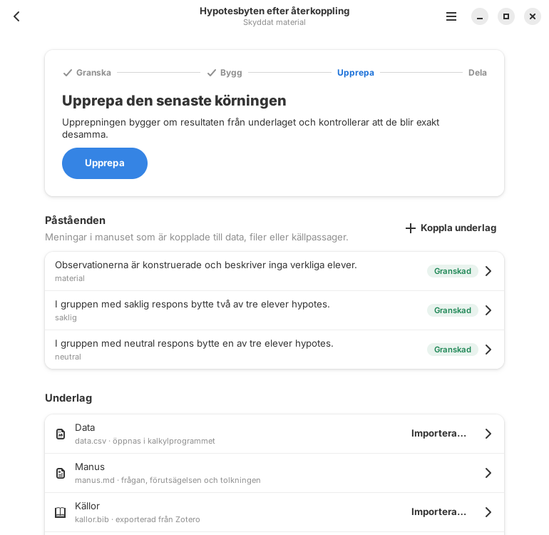
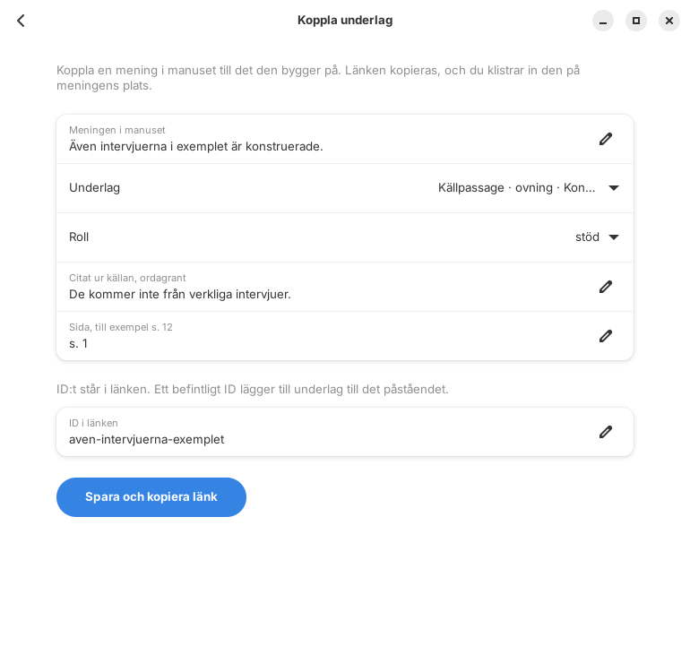

# Ett forskningsprojekt från underlag till granskning

Öppna appen **ForskarOS** i dockan eller programmenyn och välj **Nytt forskningsprojekt**. Projektet hamnar i `~/Forskningsprojekt` och får exempeldata, så att du kan prova hela arbetsflödet innan du byter till ditt eget material.

I projektet visar appen ett enda **nästa steg** med en knapp: *granska* påståendena, *bygg* rapporten, *upprepa* körningen och till sist *dela*. Stegraden överst visar var du är. Allt annat (underlag, körningar, äldre rapporter, labbet, upprepning från en annan mapp) finns i listorna och i menyn uppe till höger. Kommandoraden `forskaros-projekt` gör samma sak, se slutet av sidan.

<p align="center"></p>

<sub>Appen i en virtuell bildskärm (Xvfb) på utvecklingsdatorn, inte i en ForskarOS-VM. Typsnitt och accentfärg följer systemet och ser något annorlunda ut i ForskarOS.</sub>

| När du vill … | Börja med | Lämna vidare |
|---|---|---|
| Jämföra observationer mellan villkor | Välj *Kvantitativ*. Redigera CSV i Calc eller exportera en tabell till UTF-8. | Importera CSV med kolumnerna `villkor` och `bytte_hypotes` (0 eller 1). Exempelanalysen ger antal observationer, antal byten och andel per villkor. |
| Undersöka hur deltagare beskriver något | Välj *Kvalitativ*. Koda dokument i Taguette och exportera de markerade utdragen som CSV. | Importera exporten med `id,document,tag,content`. Tabellen kopplar varje kod och citat till dokument och utdrags-ID. Figuren räknar distinkta utdrag per kod. |
| Skriva om resultatet | Exportera relevanta poster från Zotero som BibTeX. Importera filen och öppna manuset i din Markdown-editor, exempelvis Zettlr. | Använd posternas nycklar i texten, exempelvis `[@ovning]` för exempelkällan. Pandoc sätter citaten, referenslistan och figuren i rapporten. |
| Granska och dela | Följ nästa steg: *Granska*, *Bygg rapport*, *Upprepa* och *Öppna rapporten*. | HTML-filen innehåller figuren och källhänvisningarna. Behåll `resultat.csv` bredvid HTML-filen om läsaren ska kunna öppna tabellen. För omkörning behövs hela körningsmappen. |

En CSV kan använda komma eller semikolon och UTF-8 med eller utan byteordningsmärke. För andra undersökningar ändrar du analysen och kolumnnamnen i `underlag/analys.py`. Beskriv frågan, din förutsägelse och tolkningen i `underlag/manus.md`. De medföljande observationerna, intervjuerna och referensen är övningsmaterial.

Om ingen webbläsare har installerats ännu visar appen rapporten med GNOME:s inbyggda webbkomponent. Data, manus och källor importeras med **Importera…** på respektive rad under *Underlag*. Appen läser om projektet när du kommer tillbaka från Calc eller din editor.

## Pröva en rättelse

1. Skapa ett kvantitativt exempelprojekt. Nästa steg är **Granska**. Appen visar påståendena ett i taget med observationsraderna och analysfilen de bygger på. Välj **Bekräfta granskning** för vart och ett. Bygg sedan rapporten.
2. Öppna *Data* i Calc. Ändra en etta till en nolla i gruppen *Saklig respons* och spara som CSV. När du går tillbaka till ForskarOS är nästa steg **1 påstående att ompröva**. Påståendet om saklig respons har status **Ompröva** och visar vad som ändrats. Påståendet om neutral respons står kvar som **Granskad**.
3. Håller inte meningen längre väljer du **Ändra meningen i manus**. Även ändrad lydelse kräver ny granskning. Bygg rapporten igen. Klicka på den länkade meningen i rapporten för att se det sparade urvalet och öppna analysfilen för att se hur andelen beräknades.

<p align="center"></p>

I det kvalitativa exemplet har en tolkning både ett stödjande utdrag och ett motbelägg. Ta bort raden med koden `auktoritet` ur din arbetskopia. **Underlag saknas** visar vilka tolkningar som förlorat ett angivet utdrag. Du kan öppna den tidigare körningens rapport för att läsa det citat som var tillgängligt då.

### Koppla ditt eget material

- Skriv meningen i din vanliga Markdown-editor. I projektet väljer du **Koppla underlag** och klistrar in meningen. Välj ett villkor från din tabell, ett dokument och utdrags-ID från Taguette, en källpassage eller en hel projektfil, och rollen *stöd*, *motbelägg* eller *metod*. Appen föreslår ett ID ur meningens ord. **Spara och kopiera länk** kopierar länken; klistra in den över meningen i manuset. Skriv ett befintligt ID för att lägga till fler underlag till samma påstående.
- Ett påstående visar alltid underlaget som det ser ut nu. En granskning gäller den lydelse och de underlag som visades. När underlag saknas behöver kopplingen repareras innan du kan bekräfta en ny granskning. Varje körning under *Körningar* har sin egen **Rapport**. Bygg om rapporten när du vill dela en ny bedömning.
- En koppling är en vanlig Markdown-länk, exempelvis `[Min tolkning](#belagg-min-tolkning)`. Reglerna finns i `underlag/belagg.json`. Där kan du ändra eller ta bort en koppling, skriva en kommentar och välja andra CSV-filer, matchningsvillkor och kolumner. En fil utan angivet urval följs i sin helhet, exempelvis ett analysskript. Koppla även hjälpskript eller en hel datafil om analysen beror på dem.
- Programmet kontrollerar alla träffar, inklusive dubbletter. Vyn visar högst 40 rader per urval. Ett byte av radordning påverkar inte urvalet. När ordningen är en del av metoden kan du välja hela filen. En Taguette-export innehåller de exporterade utdragen. Lägg till originaltexten separat om läsaren ska kunna kontrollera hela sammanhanget.
- I rapporten följer läsbara utdrag med i HTML-filen. Länkar till källfiler och analyskod fungerar när körningsmappen hålls samman. En människa väljer vilka samband som ska följas och avgör vad förändringen betyder för slutsatsen.

På terminalen visar `forskaros-projekt belägg "Min studie"` alla länkade påståenden. Lägg till påståendets ID för att läsa underlaget och dess avtryck. Med `forskaros-projekt granska "Min studie" mitt-id --avtryck AVTRYCK` bekräftar du just den versionen. Beslutet sparas i `underlag/granskningar.json` och följer med nästa körning. Äldre projekt går att köra vidare och kan få egna kopplingar när du behöver dem.

## Skyddat material

Välj **Skyddat material** när projektet skapas om underlaget innehåller intervjuer, personuppgifter eller annat som inte får lämna datorn (`forskaros-projekt skapa kvalitativ "Min studie" --skydd skyddad`). Valet sparas i `projekt.json` i projektmappen.

I ett skyddat projekt körs analysen och rapportbygget i en bubblewrap-sandlåda:

- inget nätverk, så analysen kan inte skicka eller hämta något
- hemkatalogen, `/tmp`, `/run` och monterade diskar är dolda; bara körningens egen mapp går att skriva i
- inga miljövariabler från din session följer med

Kan sandlådan inte startas kör ForskarOS inte analysen och säger varför. Det versionslåsta labbet (Podman utan nätverk) är ett alternativ. Hur körningen faktiskt isolerades sparas i `korning.json`.

Skyddet gäller analysen och rapporten. Program du själv öppnar, till exempel Calc, Zettlr eller en webbläsare, omfattas inte. Lägg därför inte skyddat material i molntjänster eller AI-tjänster.

Skyddsnivån står under projektets namn i rubrikraden.

## Hur säker är en körning?

Varje körning har en täckningsgrad som visas under *Körningar* i appen och med `forskaros-projekt status "Min studie"`:

| Nivå | Betyder |
|---|---|
| **Dokumenterad** | Underlag, resultat och programversioner är registrerade med SHA-256. |
| **Återkörbar** | Körningen gjordes utan nätverk och utan åtkomst utanför körningsmappen, så allt den behöver finns i mappen. |
| **Återkörd** | Minst en upprepning har gett samma SHA-256 för alla resultat. |

Varje upprepning loggas i körningens `verifieringar.json` med tid, miljö och utfall, även när resultaten avviker. En upprepning av en skyddad körning görs i sandlådan. På en dator utan bubblewrap vägrar `python3 upprepa.py` och föreslår `--utan-skydd`; en sådan upprepning loggas som oskyddad.

## Koppla ett påstående till en källpassage

Ett påstående kan bygga på en passage i litteraturen, inte bara på data. Exportera källan från Zotero som BibTeX och importera den. Välj **Koppla underlag**, välj *Källpassage* och klistra in citatet och sidan. Zoteros PDF-läsare kopierar en markerad annotering med citat.

<p align="center"></p>

ForskarOS kontrollerar:

- att källan finns i `kallor.bib`; annars visas **Underlag saknas**
- att citatet står i källtexten, om du har lagt källans text i `underlag/kallor/` (exempelvis `kallor/smith2020.md`)
- att källans identifierande uppgifter (författare, titel, år, tidskrift, sidor, DOI med flera) inte ändrats sedan granskningen; annars **Ompröva**. Fält som ofta ändras vid en ny export, till exempel filsökväg och sammanfattning, räknas inte.

Rapporten visar citatet vid påståendet. Exempelprojekten har ett påstående om att övningsmaterialet är konstruerat, kopplat till en passage i `kallor/ovning.md`.

## Forskningspaketet

Varje körning innehåller `ro-crate-metadata.json` i det öppna formatet [RO-Crate 1.1](https://w3id.org/ro/crate/1.1) med profilen [Process Run Crate 0.5](https://w3id.org/ro/wfrun/process/0.5). Den beskriver analysen som en körning med underlag, analyskod, resultat, programversioner och isolering, varje upprepning, och påståendena med de källor och filer de bygger på. Andra program som läser RO-Crate kan öppna paketet. CI kontrollerar varje paket med den officiella valideraren `rocrate-validator`.

Licensen anger du i `projekt.json`, till exempel `"licens": "https://creativecommons.org/licenses/by/4.0/"`. ForskarOS väljer ingen licens åt dig. Utan angiven licens säger paketet det, och för ett skyddat projekt står det att materialet inte får spridas utan forskningshuvudmannens tillstånd. Paketet innehåller inga namn på personer.

## Rapportens utseende

Rapporten är en läsyta: seriff, smal spalt och lugn papperston, i ljust eller mörkt läge efter läsarens inställning. Beläggen ligger samlade sist, med status i ord. Utseendet styrs av `underlag/rapport.css`, som följer med varje körning. Därför bygger en upprepning exakt samma rapport. Du kan ändra filen; nästa körning använder din version. Projekt som skapades före 2027.1-beta4 saknar filen och byggs som förut.

## Vad en körning bevarar

Projektets `underlag/` är arbetsmappen. *Bygg rapport* kopierar hela mappen till en ny daterad undermapp i `korningar/` och kör analysen på kopian. Tidigare körningar kan därför återskapas efter att du har ändrat data eller manus. Vid avbruten eller misslyckad analys publiceras ingen färdig körning. Lägg bara filer som ska följa med analysen i `underlag/`. Ett kvalitativt underlag och dess resultattabell innehåller själva citaten.

I varje körning finns `korning.json` med SHA-256 för underlag, resultat och körprogram samt versionerna av Python och Pandoc och maskinens arkitektur. Figurfilen och rapporten kan öppnas oberoende av analysmiljön. En SHA-256-jämförelse visar om filerna matchar den sparade förteckningen. När förutsägelsen registrerades måste beläggas separat om studien kräver förregistrering.

**På kollegans dator:** kopiera en enskild körningsmapp, läs analyskoden och välj *Upprepa en körning från annan mapp…* i projektets meny. Verktyget kontrollerar det sparade underlaget och resultaten, kör analysen i en ny temporär mapp och jämför de nya filerna byte för byte. Även en redigerad CSV, en borttagen fil eller en annan figur ger ett namngivet fel.

Med lokal körning behövs Python 3 och Pandoc 3. De ingår i utvecklingsavbildningen. På en dator utanför ForskarOS kan kollegan öppna den kopierade mappen och köra `python3 upprepa.py`. Andra programversioner kan ge andra byte för ett numeriskt likvärdigt resultat.

För en versionslåst körning, välj *Kör i versionslåst labb* i projektets meny innan du bygger. Första hämtningen kräver nät. Körningen sparar den använda containeravbildningens digest. *Upprepa* på en annan ForskarOS-maskin väljer den avbildningen. Själva analysen körs med containerns nätverk avstängt. Använd kompatibel processorarkitektur för den sparade avbildningen.

```bash
forskaros-projekt skapa kvantitativ "Min studie"
forskaros-projekt kör "Min studie"
# Alternativt i ForskarOS-labbet
forskaros-projekt kör --labb "Min studie"
# Ange en av de körningsmappar kommandot ovan skriver ut
forskaros-projekt upprepa "Min studie/korningar/KÖRNINGENS-NAMN"
```

## Välj verktyg efter vad du behöver lämna vidare

| Uppgift | Verktyg och överlämning |
|---|---|
| Litteratur och läsning | Spara den källa du hittat i Firefox till Zotero. Markeringar i en PDF från Xournal++ kan hjälpa dig att återfinna sidan. Exportera de källor du faktiskt citerar till projektets BibTeX-fil. Perplexity, Elicit och Consensus är tillval för sökning. Kontrollera originalkällan före import. |
| Samtal och kodning | Speech Note kan ge ett lokalt textutkast. Läs igenom det, spara texten och importera den i Taguette. Dess export av kodade utdrag är underlaget för det kvalitativa projektet. |
| Statistik | Calc lämpar sig för en liten tabell. DuckDB kan ta fram ett urval ur en större datamängd. JASP eller jamovi kan öppna tabellen för en separat statistisk analys. LabPlot kan användas för att utforska ett diagram. För att få med en bearbetning i omkörningen måste den uttryckas i projektets analyskod. |
| Kod och beräkning | VSCodium kan redigera analysen. JupyterLab och RStudio kan användas för att utforska data. Flytta de valda stegen till analyskoden. Python kan där anropa ett eget R-skript i ForskarOS-labbet. För lokala extraberoenden kan uv användas i en egen miljö. |
| Perspektiv och skisser | Freeplane ger en begreppskarta, draw.io en modell och Rnote en skiss. Exportera den valda bilden till `underlag/` och länka från manuset, exempelvis ``. Den följer med rapporten och dess kontrollsumma sparas. |
| Text och publicering | Samma Markdown-manus kan redigeras i Zettlr eller Obsidian. Pandoc bygger projektets HTML. Behövs ett särskilt slutformat kan LibreOffice eller ONLYOFFICE användas för Word, TeXstudio för LaTeX och Typst för en egen PDF-layout. De efterbearbetningarna ligger utanför standardkörningen. |
| Lokal AI | Alpaca kan användas med Ollama för att pröva en alternativ tolkning. Anteckna vad som ändrade analysen i manuset. En lokal körning behöver ingen AI-tjänst. |
| Arkiv och sökning | ripgrep hittar ett citat eller utdrags-ID i filerna. DataLad och git-annex kan versionshantera större underlag före export. Lägg materialiserade vanliga filer i `underlag/`. Déjà Dup kan säkerhetskopiera projektmappen, inklusive tidigare körningar. |
