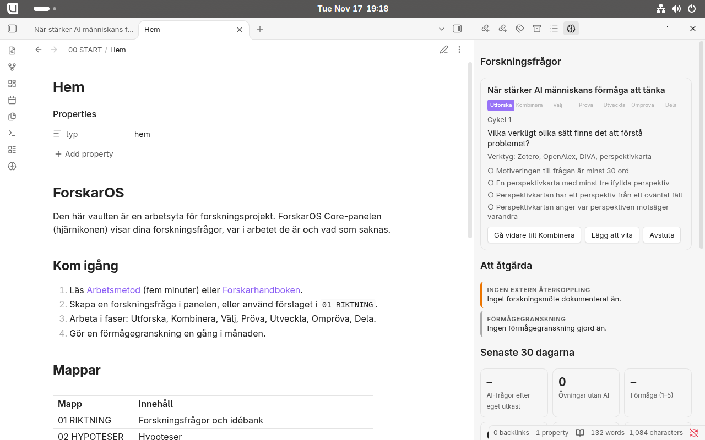
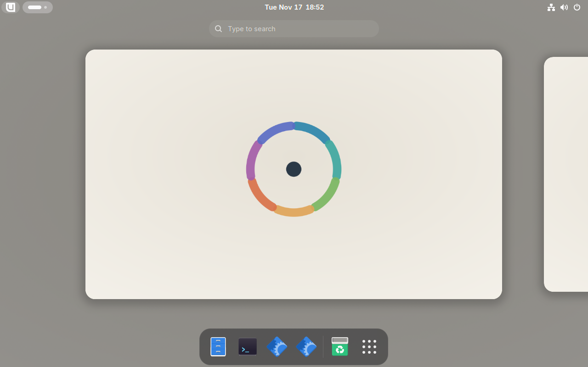

# VM-test av ForskarOS 2027.1-beta1

Testdatum: **2026-11-17**. Den publicerade amd64-avbildningen startar till ett fungerande GNOME-skrivbord. ForskarOS Core fungerar i riktig Obsidian inne i samma VM. Testet verifierar grundläggande användarflöden, inte hela distributionen eller alla forskningsverktyg.

## Avbildning och miljö

| Del | Testad konfiguration |
|---|---|
| Nedladdning | [ForskarOS-2027.1-beta1-amd64.qcow2](https://archive.org/download/forskaros-2027.1-beta1-amd64-vm/ForskarOS-2027.1-beta1-amd64.qcow2) |
| SHA-256 | `d04096edb9629ec6be759a3d722ea85ee8ae8e2e8554c3169ecf9b7e07b781fa` — överensstämmer med publicerad kontrollsumma |
| Källkod vid granskningen | [`b9cf4f5`](https://github.com/Jtensetti/researchOS/commit/b9cf4f5cc020d2beca76150be92cab2b17bf9f87) |
| Hypervisor | QEMU 10.0.13, q35, OVMF/UEFI, TCG med flera trådar |
| Resurser | 4 virtuella CPU:er, 4 GiB RAM, virtio-disk, virtio-grafik, NAT |
| Disk | Separat skrivbart qcow2-lager; nedladdad originalavbildning oförändrad |
| Gäst | Bluefin LTS, CentOS Stream 10, kärna `6.12.0-273.el10.x86_64` |
| Program | Obsidian 1.15.1, ForskarOS Core 0.3.0 |

KVM var inte tillgängligt. CPU:n emulerades med TCG, vilket gav långsamma uppdateringar. **Testet kan därför inte användas för att bedöma normal prestanda på en dator eller i en hårdvaruaccelererad VM.**

## Genomförda kontroller

| Kontroll | Utfall |
|---|---|
| Start av publicerad qcow2 med UEFI | Godkänd: grafisk inloggning visas |
| Första inloggning med `forskare` | Godkänd: obligatoriskt lösenordsbyte går att genomföra |
| GNOME-skrivbord och ForskarOS-bakgrund | Godkänd |
| Första startens konfiguration | `forskaros-setup` öppnas och vaulten skapas i hemkatalogen |
| Ny start med samma skrivbara disk | Inloggning med det ändrade lösenordet fungerar; vaulten finns kvar |
| Automatisk installation av grundverktyg | Blockerad av DNS/nätverk i testmiljön; inte verifierad |
| Öppna vaulten och aktivera Core i riktig Obsidian | Godkänd |
| Aktivera exempelfrågan om AI och tänkande | Godkänd: `status: aktiv`, `fas: utforska` och `cykel: 1` sparas i anteckningen |
| Försöka gå vidare med ouppfyllda faskrav, utan motivering | Godkänd: dialogen visar kraven, meddelandet ”Skriv en motivering.” visas och fasen ändras inte |
| Skapa en hypotes | Godkänd: mall, metadata och länk till den aktiva forskningsfrågan skapas |
| AI-dialog på en ny hypotes | Räknar 0 egna ord och spärrar utvecklings- och prövningsläget; väljer samtidigt prestationsläge automatiskt, se bedömning nedan |
| Befintlig kontrollsvit: `bash scripts/check.sh` | Godkänd på värdsystemet: bland annat 39 metodtester, tilläggstester mot simulerat Obsidian-API, skriptkontroller och länkar i vaulten |

Core-filen i gästen matchade källkodens SHA-256:

```text
1c7bddb7233681d66278e895d59293c7e108279518f96b1cd0f87e953d3b0db6  main.js
```

Kontrollsvitens tester av exempelvis UTM-paketering och labbkommandot är inte bevis på att UTM eller labbcontainern har körts i detta test. En full forskningscykel, lyckat fasbyte med motivering och AI-dialogens kopiering/loggning provades inte interaktivt.

## Installation och testanpassningar

Gästen kunde inte slå upp Flathubs värdnamn. Tjänsten `forskaros-grund.service` försökte igen med två minuters mellanrum. Loggen innehöll:

```text
error: Can't load uri https://dl.flathub.org/repo/flathub.flatpakrepo:
While fetching https://dl.flathub.org/repo/flathub.flatpakrepo:
[6] Could not resolve hostname
```

Detta visar att installationen inte blev klar i denna miljö. Det visar **inte** att Flathub-installationen är trasig på ett vanligt nätverk.

För att ändå kunna testa Core hämtades [Obsidian 1.15.1:s officiella Linux-arkiv](https://github.com/obsidianmd/obsidian-releases/releases/download/v1.15.1/obsidian-1.15.1.tar.gz) på värdsystemet och fördes över till gästen. Appen packades upp i testanvändarens hemkatalog. Detta var en manuell testinstallation, inte distributionens ordinarie Flatpak-flöde.

I den isolerade testgästen startades Obsidian med Wayland, `--disable-gpu`, `--no-sandbox` och en lokal felsökningsport för automatiserade kontroller av det riktiga gränssnittet. Dessa flaggor är inte en rekommendation för vanlig användning. En tillfällig SSH-nyckel och gästagentinställning användes för teststyrning. SELinux stängdes inte av. Inga ändringar gjordes i Core-koden eller den nedladdade originalavbildningen.

## Bedömning och prioriteringar

**En fungerande prototyp med en tydlig metod, men introduktionen behöver bli mer sammanhängande.** Det mest övertygande i testet är att forskningsfrågan, hypotesmallen och kraven på nästa fas faktiskt hänger ihop i lokala anteckningar.

1. **Visa installationens tillstånd för användaren.** I testet fanns skrivbordet, men grundverktygen saknades medan bakgrundstjänsten försökte igen. Visa vad som laddas ned, vad som misslyckats och hur installationen återupptas. En färdig introduktion bör också leda hela vägen till vaulten och Core.
2. **Gör prestationsläge till ett uttryckligt val.** Med 0 egna ord är de två lägena för lärande/prövning spärrade, men prestationsläge väljs automatiskt och ”Kopiera och logga” är tillgänglig. Det följer kodens regler, men försvagar principen om eget tänkande först. Be användaren välja undantaget aktivt och förklara konsekvensen.
3. **Anpassa fasraden till smala paneler.** Vid den inledande panelbredden kapas flera fasnamn. Den slutliga README-bilden använder en bredare panel. Prova exempelvis en vertikal faslista eller visa aktuell och nästa fas tydligare.
4. **Lägg till ett automatiserat starttest.** Bygg- och regeltester är värdefulla, men en CI-körning som startar den publicerade avbildningen och kontrollerar inloggning, vault och installationstjänst skulle fånga en annan klass av fel.

ARM/Apple Silicon/UTM, ISO-installation, fysisk hårdvara, full verktygsinstallation, R/Python-labbet och lokala AI-modeller ingår inte i detta test.

## Skärmdumparnas ursprung

Skärmdumparna kommer direkt från QEMU:s bildskärm via `screendump`, konverterade förlustfritt från PPM till PNG. Inget gränssnitt har återskapats eller genererats för bilderna.

Obsidian visar den medföljande startsidan och den aktiverade exempelfrågan. Vänster sidofält har fällts ihop och Core-panelen breddats för läsbarhet.



GNOME:s översiktsvy efter första inloggningen:


